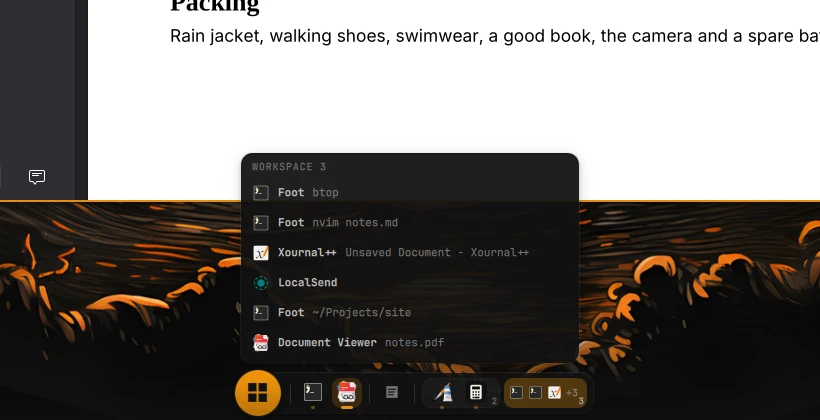
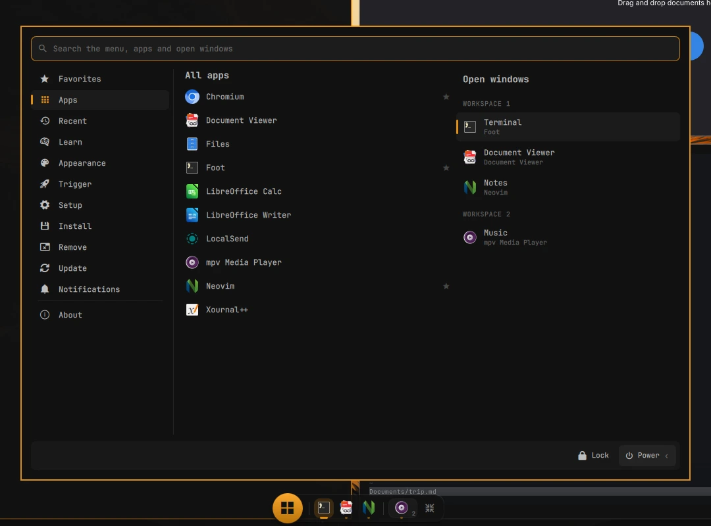

# omext taskbar

Part of [**omarchy-extended**](https://github.com/omarchy-extended): addons for [Omarchy](https://omarchy.org).

A small taskbar at the bottom of every screen that keeps out of the way. It
waits below the edge; move the pointer down to it, anywhere along it, and it
comes up, with a soft shade fading up from the edge behind it. Move up off the
bar and it goes down again. Every open window is on it, or one
click away.



## What's on it

Left to right:

0. **[omext start](https://github.com/omarchy-extended/start)**, if you put it
   here (Start's Settings › Bar button › On the taskbar): a round button at the
   taskbar's left end, in place of the one on the top bar. Its menu opens
   centred above the taskbar, and the taskbar's own clicks still work under it.
1. **The windows in front of you**, on the workspaces your screens show now
   (with a little room between one workspace and the next). The focused one has
   a wide accent line.
2. **The minimized windows**, dimmed. A click brings one back onto the workspace
   in front of you.
3. **Every other workspace**, framed, with its number small in the corner. Up
   to five windows show right on the bar, to click. With more (or when the bar
   has no room for them all), it's one button with its first apps' icons, and a
   click lists its windows. After them, a button that brings every one of those
   windows onto the workspace in front of you.
4. **Each [omext dock](https://github.com/omarchy-extended/docks)** with apps
   running in it, as one small button: a dock icon for its edge, with how many
   apps are running in it in the corner. A click lists them; picking one opens
   the dock on it.

A click on a window goes to it. A click on the focused one minimizes it.
Middle-click closes one, and so does the ✕ in a list. With
[omext arrange](https://github.com/omarchy-extended/arrange), a right click opens
its small map of the screen's zones above the icon: click one to put the window
there, or Quit app (every window of that app is asked to close). Hovering shows the app's
name and the window's title; the lists show both too ("Files", then the folder
it's in).

It stays down while a window is fullscreen.

**Gather on unplug**, if you turn it on (the Omarchy menu › Setup › Omarchy
Extended › Taskbar: Gather on Unplug): when you unplug a screen, the windows that
were on it come onto the workspace in front of you, instead of staying on its
workspaces out of sight. It's `gatherOnUnplug` in `~/.config/omext/taskbar.json`.



## One icon per app

An app's windows share one icon, with how many in its corner: the ones in front
of you, and its windows on other workspaces and minimized ones too (not the
ones in a dock). A click on it lists them, each with where it is when it isn't
in front; a click on one goes there. With one window, the click goes straight
to it. A pinned app's icon does the same when the app has several windows
elsewhere. To have an icon per window as before:

```bash
omext-settings set taskbar group false
```

## Pinned apps

Apps you pin keep an icon at the left of the taskbar, running or not, in the
order you pinned them. A click on one goes to its window (on another workspace,
or minimized), or starts the app. While it has a window in front of you, that
window's icon stands in its place.

The taskbar's apps are windows; the [omext docks](https://github.com/omarchy-extended/docks)'
are the docks'. A pinned app that a dock has too starts as a window of its own,
outside the dock. Only when it is already open in a dock, and is an app that
runs once, does the click go there. Each dock's button on the taskbar lists
every app the dock has, open or not: a click opens it in its dock.

- **Pin or unpin:** right-click a window's icon. With
  [omext arrange](https://github.com/omarchy-extended/arrange) the zone map that
  opens has a "Pin to taskbar" line; without it, a small menu shows.
- **Unpin an app that isn't running:** right-click its icon.
- The list is `pins` in `~/.config/omext/taskbar.json` (desktop entry ids).

## By keyboard

The taskbar has a key of its own if you set one (none by default): Omarchy menu
› Setup › Omarchy Extended › Taskbar: Keyboard Key turns on Super + Ctrl + J, or
set any other:

```bash
omext-settings set taskbar key '"SUPER + ALT + T"'
```

The key brings the taskbar up with the keyboard on it, and takes it down again.

| Key | Does |
| --- | --- |
| Left / Right (Tab / Shift + Tab) | The next thing on the bar; its name shows over it |
| Enter | A click on it: go to the window, open a group's list, Start, bring all here |
| Up / Down | In a group's open list |
| Delete | Close the window chosen |
| Esc | Leave a list, then the taskbar |

## From a script

```bash
omarchy-shell omext.taskbar show       # up for a moment, on the screen with the focus
omarchy-shell omext.taskbar list 3     # workspace 3's list; or list dock:<id>
omarchy-shell omext.taskbar gather     # every window out of sight, onto the focused screen's workspace
```

## Install

```bash
git clone https://github.com/omarchy-extended/taskbar.git ~/.local/share/omext-taskbar
~/.local/share/omext-taskbar/install.sh
```

Turn it off or on in the Omarchy menu › Setup › Omarchy Extended › Taskbar. A
`git pull` in that folder updates it. `./uninstall.sh` removes it.

Needs **Omarchy 4.5** or later. Minimizing is Omarchy's own (on floating
workspaces).

It uses [omext core](https://github.com/omarchy-extended/core) (what the omext
addons share): `install.sh` installs that too, when it's missing.

**In place of Omarchy's dock.** The two would collide at the bottom edge, so
while the taskbar is on, Omarchy's dock is off: omext core turns it off, and
back on when the taskbar is turned off or removed (unless omext start is keeping
it off too).

## License

MIT. See [LICENSE](LICENSE).
